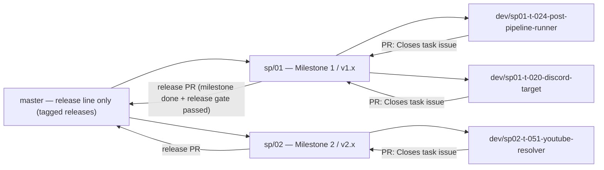
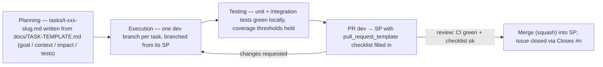

# PROCESS — Development Process

This document is the **complete** definition of how NewsQuack is developed: branch model, task lifecycle, GitHub tracking, subagent access rules and commit conventions. `AGENTS.md` at the repo root carries a binding summary for development subagents; when in doubt about *why* a rule exists, read this document.

---

## 1. Branch model



### Rules

| Rule | Detail |
|---|---|
| **`master`** | The main line. Only tagged releases (`v1.0`, `v1.1`, `v2.0`, …) land there, via a **release PR** from the corresponding SP branch. No direct pushes, no feature work. |
| **Service packs (`sp/NN`)** | One SP per milestone of the plan: `sp/01` = Milestone 1 (the v1.x iteration line), `sp/02` = Milestone 2 (v2.x), and so on. An SP branch is created **from `master` at the start of the milestone** and stays open until that milestone ships. |
| **Dev branches** | Named `dev/<sp>-<task-id>-<slug>`, e.g. `dev/sp01-t-024-post-pipeline-runner`. Pattern: lowercase, hyphen-separated; `<task-id>` is the task ID lowercased (`T-024` → `t-024`); `<slug>` is a short kebab-case description of the task. |
| **Self-contained dev branches** | A dev branch is born **from its own SP** and merges **back into its own SP** via PR. Never: dev → master directly, or porting a dev branch between two SPs inside the same milestone. |
| **PR-only merges** | Every merge on GitHub happens through a pull request. Squash-merge (or rebase-merge) so the SP history stays linear and each task = one squashed commit with the PR title as its message. No generic "Merge branch …" commits. |
| **Release flow** | `Sp → Main`: when all tasks of the milestone are merged into the SP and the release gate (CI green + soak test passed) is satisfied, a release PR merges the SP into `master` and tags the version. |

Full flow in one line: **Main → Sp** (SP created from master at milestone start) · **Sp → Dev** (branch per task) · **Dev → Sp** (PR that closes the task issue) · **Sp → Main** (release PR when the milestone is done).

---

## 2. Task lifecycle



1. **Planning.** The coordinator writes `tasks/t-<nnn>-<slug>.md` from `docs/TASK-TEMPLATE.md`: goal, context (only what the dev needs), impact assessment, implementation notes, test plan, definition of done. A GitHub issue is opened mirroring the task (section 3).
2. **Execution.** One dev branch per task (`dev/<sp>-<task-id>-<slug>`). The development subagent works with *only* `AGENTS.md` + its task file + git history (section 4).
3. **Testing.** Every task ships tests; the PR must show what was added and how to run it.
4. **PR dev → SP.** Uses `.github/pull_request_template.md`; the PR body's `Closes #<issue>` closes the task issue on merge.
5. **Merge & close.** Squash-merge into the SP; the issue auto-closes; the task file is marked done (checkboxes in its Definition of Done).

### Plans can change — traceability rule

A task's plan may legitimately change in a later milestone (e.g. a v1.0 task reworked for v2.x). When that happens, **the task file is updated in the very commit that changes the scope** — never silently. Git history then answers "what did we think at the time" (`git log -p -- tasks/t-xxx-slug.md`). This keeps planning documents honest without a separate changelog.

---

## 3. Tracking on GitHub

| Artifact | Convention |
|---|---|
| **Issue per task** | Title = task name (e.g. `T-024 PostPipelineRunner + v1.0 stages`); body = the plan from the task file (goal, context, impact, test plan, DoD). Labels: milestone (`M1`, `M2`, …) + workstream (`WS1`…`WS4`). |
| **Epic per milestone** | One epic issue per milestone listing its tasks; the SP branch name and the epic are 1:1. |
| **PRs** | `Closes #<task-issue>` in the PR body → the issue closes on merge. One task = one PR (small, focused). |
| **Releases** | Tagged on `master` after a release PR; release notes list the merged tasks and the soak-test results. |

---

## 4. Subagent access model

| Subagent kind | Access | Why |
|---|---|---|
| **Analysis** (planning, review, investigation) | Full repo + `~/newsquack-analysis/` (original project analysis, PM plan, issues) | They must see the whole picture to plan and review correctly. |
| **Development** | Only: `AGENTS.md` + its own task file in `tasks/` + git history & existing code (`git log`, `git show`) | Two reasons: **(1) no future-info leakage** — knowing what comes next (reserved pipeline slots, planned targets, later milestones) tempts a dev subagent to build for the future and bloat the diff; **(2) focused diffs** — with only its task in view, changes stay inside the task's impact radius, which is what makes small PRs reviewable and merge conflicts rare. |

Consequences: contracts (`Post`, `IPostStage`, `INotificationTarget`, `IStateStore`, …) are read from **code**, not from planning docs; anything missing from a task file is a question to the coordinator, never an assumption.

---

## 5. Commit convention

**Conventional Commits**, always in English:

```
<type>(<optional scope>): <imperative summary>
```

| Type | Use for | Example (this project) |
|---|---|---|
| `feat` | New functionality from a task | `feat(store): add DeliveredItem entity with EF Core mapping` |
| `fix` | Bug fix, ideally referencing the regression it removes | `fix(pipeline): skip enrichment when item already delivered` |
| `refactor` | Restructure without behavior change | `refactor(builder): replace hardcoded host routing with IPostBuilder strategies` |
| `test` | Tests without production code change | `test(dedup): cover crash between send and confirm (at-least-once)` |
| `docs` | Documentation only | `docs(readme): document env var overrides for webhook tokens` |
| `chore` / `ci` | Build, tooling, CI plumbing | `ci: cache NuGet packages in build-test job` |

Rules:

- **One commit = one complete, tested logical unit.** No WIP commits; if a change is not finished and green it is not committed.
- **No generic merge commits** — PRs are squash-merged so each task contributes exactly one commit whose message is the PR title (which follows the same convention).
- Scopes use module names (`store`, `pipeline`, `dedup`, `config`, `discord`, `ci`…) — they must match where the change lives.
